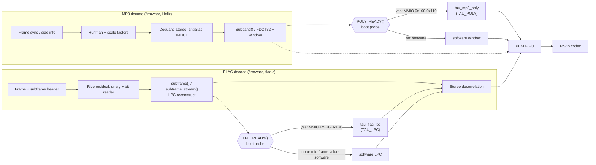
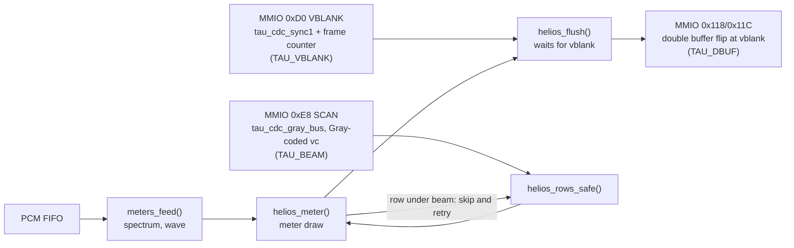

# Cymo: v0.6.0 Audio Pipeline

Scope: audio decode (MP3, FLAC), the two hardware kernels, and how Helios vblank/beam gate the visuals. Register-level detail is in `docs/MMIO_ALLOCATION.md`; the hardware view is in `HALCYON_v0.6.0_HARDWARE_SOFTWARE_ARCHITECTURE.md`.

## 1. Decode pipelines and kernels

## 2. Helios integration (display, not audio)

## 3. Hardware kernels

**MP3 window unit, `tau_mp3_poly.sv` (B-292).** FDCT32 results are pushed in, the unit runs Helix's 512-MADD64 polyphase window and returns the PCM words. History is one 1024 x 32 array (4 M10K, B-290 estimate). Bit-exact against Helix `PolyphaseStereo` on 170 slots, four mutants killed in simulation.
- MMIO: `0x100` POLY_CTL, `0x104` POLY_PUSH, `0x108` POLY_IDX, `0x10C` POLY_OUT, `0x110` POLY_ST (bit 0 = built in, 0 when off).
- Firmware: `fw/mp3_poly_hw.h`, build macro `POLY_FW`; RTL macro `TAU_POLY`.
- Measured effect (B-588, DEV 88, pipelined handoff): CPU busy 55% to 47%, Subband software share 20% to 12%, hardware-wait share 3%. Before the unit, Subband was 55-59% of realtime (B-086 era readings).

**FLAC LPC unit, `tau_flac_lpc.sv` (B-368, B-372, B-378).** One time-multiplexed multiply-accumulate (one DSP block, 48-bit accumulator; 45 bits proven sufficient, B-365/B-366).
- States (as built): `IDLE, MAC, MAC2, SHIFT, ADD, PUSH, DONE`. `MAC2` was added by B-378 for the registered MLAB read. One multiply-add per clock over `order` taps, then shift, add residual and history push as separate registered cycles.
- Coefficients and history live in MLAB, up to 32 taps (order 1-32).
- MMIO: `0x120` LPC_CFG, `0x124/0x128` coefficient index/data, `0x12C/0x130` warm-up index/data, `0x134` LPC_RESIDUAL (starts a reconstruction), `0x138` LPC_SAMPLE (reading it is the acknowledge), `0x13C` LPC_STATUS.
- Firmware: `fw/flac_lpc_hw.h/.inc`, build macro `LPC_FW`; RTL macro `TAU_LPC`. B-370 fixed two redirect bugs (residual consumed before the success check; a duplicate `i++`), pinned by `sim/test_flac_lpc_fw_redirect.py`.
- FLAC cost on a Pocket (B-363, before the unit): channel 0 33-36%, channel 1 63-66%, total about 99% of realtime.

## 4. Build flags

| Flag | Where | Default |
|------|-------|---------|
| `POLY_FW`, `LPC_FW` | firmware, use the hardware kernel when its probe passes | 0; on for diagnostic targets |
| `TAU_POLY`, `TAU_LPC`, `TAU_VBLANK`, `TAU_BEAM`, `TAU_DBUF` | bitstream; a missing unit reads as 0 and the probe fails to the software path | per fit bundle |

## 5. Timing evidence (what is and is not claimed)

- Latest fit with LPC and blend together: `glyphbuf-t200`, B-398, seed 2 selected, all four corners positive. Minimum setup +0.963 ns, minimum hold +0.119 ns. RAM 240/308 M10K, DSP 19/66.
- The older `all6-combined-s1` fit (B-371 VM check) predates LPC; its +0.037 ns hold margin is not the current figure.
- Not drawn because the audit trail does not support them: a D/A/X split of the MP3 stages, and a DSP count for the window unit alone (B-290 estimated 1-2 DSP blocks; not measured per unit).
- Alpha blend (B5): the standalone fit once failed at -2.972 ns. Pipelining (B-327) closed timing, and B-398 closed it again inside the combined bundle. Hardware behaviour of the Scope trail was still being investigated later (B-411 to B-439), so "timing closed" is the claim, not "visually proven".

## 6. Open items

1. FLAC at about 99% of realtime before the unit; channel 1 dominated.
2. `glyphbuf` MLAB inference fell back to M10K in the old combined fit; T2-00 (B-398) later changed the ALM picture, so recheck before drawing it as a defect.
3. Track-change Check failure, unexplained.

Evidence: `docs/AUDIT_TRAIL.md` B-290, B-292, B-363, B-365..B-378, B-398, B-588. Redrawn 2026-10-26 from the repo; the fit and measurement figures are dated by their B-entries above.
