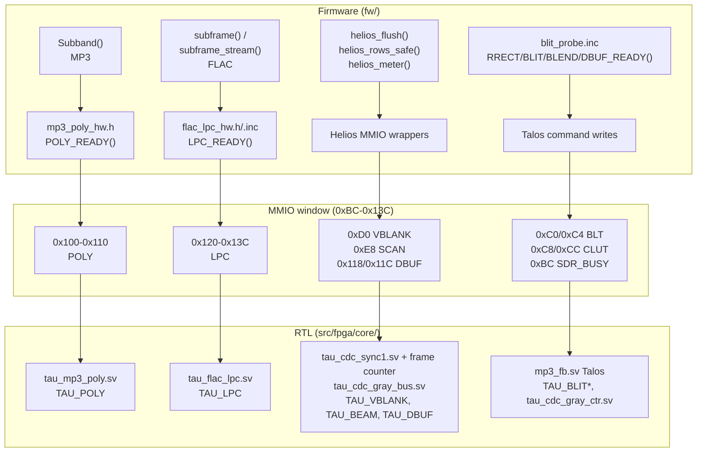

# Halcyon: v0.6.0 Hardware/Software Implementation

Scope: RTL kernels, the MMIO window and the firmware that drives them. Not the UI and not Tau Omega. Authoritative register list: `docs/MMIO_ALLOCATION.md` (the window is 128 slots; `0x100` and above alias `0x00..0xFC` unless the decode is widened, which the bitstream does).

## 1. Layers

Boot probes (called POLY_READY and LPC_READY in the docs; the code has no macros of those names): `player.c` reads bit 0 of `POLY_ST` / `LPC_STATUS` once at start-up and sets `tau_poly_hw_enable` / `tau_lpc_hw_enable`. A bitstream without the unit reads 0, so the software path runs. A real hardware timeout later clears the flag for the rest of the session (permanent software fallback). A failed LPC call mid-frame falls back for that frame (B-370 tests).

## 2. Hardware units

**`tau_mp3_poly.sv` (B-292), MMIO 0x100-0x110, `TAU_POLY`.** Polyphase window for MP3 Subband.

| Addr | Name | Dir | Meaning |
|------|------|-----|---------|
| 0x100 | POLY_CTL | W | bit 0 clear history, bit 1 go |
| 0x104 | POLY_PUSH | W | one FDCT32 output word, 64 per slot |
| 0x108 | POLY_IDX | W | PCM word 0..31 to present |
| 0x10C | POLY_OUT | R | `{R[31:16], L[15:0]}` |
| 0x110 | POLY_ST | R | bit 0 built in, bit 1 busy, 31:16 slots computed |

**`tau_flac_lpc.sv` (B-368, B-372, B-378), MMIO 0x120-0x13C, `TAU_LPC`.** FLAC LPC reconstruction.

| Addr | Name | Dir | Meaning |
|------|------|-----|---------|
| 0x120 | LPC_CFG | W | order 1-32 (5:0), right shift (11:6) |
| 0x124 / 0x128 | COEF_IDX / COEF_DATA | W | coefficient slot; data auto-increments |
| 0x12C / 0x130 | WARM_IDX / WARM_DATA | W | warm-up history slot; data auto-increments |
| 0x134 | LPC_RESIDUAL | W | writes the residual and starts one sample |
| 0x138 | LPC_SAMPLE | R | result; the read acknowledges and frees the unit |
| 0x13C | LPC_STATUS | R | bit 0 built in, bit 1 busy, bit 2 done |

State machine: `IDLE, MAC, MAC2, SHIFT, ADD, PUSH, DONE`. One multiply-add per clock into a 48-bit accumulator (45 bits proven enough), one DSP block, coefficients and history in MLAB with a single driver per array (B-372).

**Helios.** `0xD0` VBLANK: level plus 16-bit frame counter, about 60 Hz on hardware. `0xE8` SCAN: bit 9 present, bits 8:0 the video line counter, Gray-coded across the clock domain; `helios_rows_safe()` skips and retries on a beam collision. `0x118` DBUF_CPU / `0x11C` DBUF_DISP: draw-buffer select and flip, applied only at vblank. `0xBC` SDR_BUSY: SDRAM busy-cycle counter.

**Talos blit engine** (opcodes as built in `mp3_fb.sv`):

| Op | Name | Status |
|----|------|--------|
| 0 | OP_RUN | idle/scanout |
| 1 | OP_RECT | solid fill |
| 2 | OP_CHAR | glyph |
| 3 | OP_COPY | copy; also carries the blend and colour-key sticky fields |
| 4 | OP_BLIT | general blit |
| 5 | OP_BAR | meter column, 9-bit widen hardware-confirmed (B-459) |
| 6 | OP_SBLIT | scaled blit |
| 7 | OP_CBLIT | 256-entry CLUT blit, hardware-proven |
| 8 | OP_RRECT | rounded rect, timing-fixed |
| - | B5 alpha blend | sticky field on the copy path; pipelined in B-327 |

B12-B17 are designed, not built.

Alpha blend history, reconciled: a standalone fit once failed at -2.972 ns (the shelved state). B-327 pipelined it and closed timing. B-398 closed it again inside the combined LPC bundle. Closure is a fit result; the Scope-trail behaviour on a Pocket was still under investigation in B-411 to B-439.

## 3. Firmware hooks and builds

- Redirects: `Subband()` (MP3); `subframe()` and `subframe_stream()` (FLAC).
- Software is the reference path; `sim/test_flac_lpc_fw_redirect.py` compares the 8 combinations of unit on/off against clean, mid-frame failure and early failure (B-370 bugs).
- Macros: `POLY_FW`, `LPC_FW` (firmware, default 0, on for diagnostic targets); `TAU_POLY`, `TAU_LPC`, `TAU_VBLANK`, `TAU_BEAM`, `TAU_DBUF`, `TAU_BLIT_BLEND` (bitstream).
- The shipped link is 192 KB (`RAM_192K=1 CLK66=1 SDRAM_BUSY=1`).

## 4. Fit evidence

- `glyphbuf-t200` (B-398): blend + LPC together, both seeds Successful, seed 2 selected, all four corners positive (min setup +0.963 ns, min hold +0.119 ns), M10K 240/308, DSP 19/66. The earlier `lpc-b372` bundle had overflowed the LAB budget (B-376).
- The `all6-combined-s1` fit (B-371, +5.695 / +0.037 ns) has no LPC and is superseded.

## 5. Open items

1. FLAC about 99% of realtime before the unit; channel 1 dominated (B-363).
2. Track-change Check failure, unexplained.
3. Re-verify the `glyphbuf` MLAB inference on the current bundle.

Evidence: `docs/AUDIT_TRAIL.md` B-292, B-327, B-363, B-365..B-378, B-398, B-404, B-459. Redrawn 2026-10-26 from the repo.
